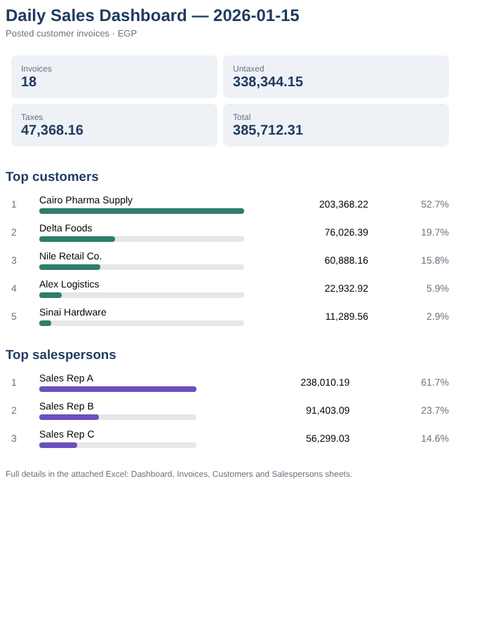

# odoo-ai-lab

   

Business automations that connect **Odoo ERP** to **n8n**. I design each one and AI agents build it: I write the business spec, Claude builds the workflow through the n8n MCP server, and I review and test it against a staging Odoo database before it goes live.

> Background: Odoo functional and technical consultant, now moving into AI engineering.
> This repo is my public lab. Each folder is one importable n8n workflow with its own README.

## Workflows

| # | Workflow | What it does | Trigger |
|---|----------|--------------|---------|
| 01 | [Contacts missing email](01-contacts-missing-email/) | Finds Odoo contacts that have no email (a data-quality check) | Manual |
| 02 | [Daily invoices totals (CSV)](02-daily-invoices-csv/) | Today's posted customer invoices, untaxed / taxes / total per invoice plus a TOTAL row, saved as CSV | Daily 23:30 (Cairo) |
| 03 | [Daily sales dashboard (Excel + email)](03-daily-sales-dashboard/) | Builds a 4-sheet Excel dashboard (KPIs, top customers, top salespersons) and an HTML email | Daily 23:30 (Cairo) |

## Stack

- **Odoo 18** (Odoo.sh staging), read over JSON-RPC with the n8n Odoo node
- **n8n Cloud** for scheduling, Code nodes (JavaScript) and Gmail
- **Claude + n8n MCP**: workflows are generated, validated and test-run by an AI agent from a written spec

## How to import

1. In n8n, go to **Workflows → Import from file** and choose a `workflow.json`.
2. Create your own credentials (**Odoo**: URL, database, user, API key; **Gmail** OAuth) and select them on the nodes marked `REPLACE_ME`.
3. Run the manual trigger to test, then publish to turn on the schedule.

## Safety

- Credentials are never committed. Exports keep only placeholder credential references.
- All testing ran against a **staging / neutralized** Odoo copy, never production.
- Screenshots and sample files use **made-up demo data**.

## Roadmap

- Odoo → AI: an LLM summary of the day's sales, with anomaly flags
- RAG over Odoo documentation and records
- Self-hosted n8n on Docker with native Excel charts

## Contact

**Ahmed Ali Saleh**, Odoo Team Leader, Cairo, Egypt. Open to Odoo + AI automation roles and projects.
